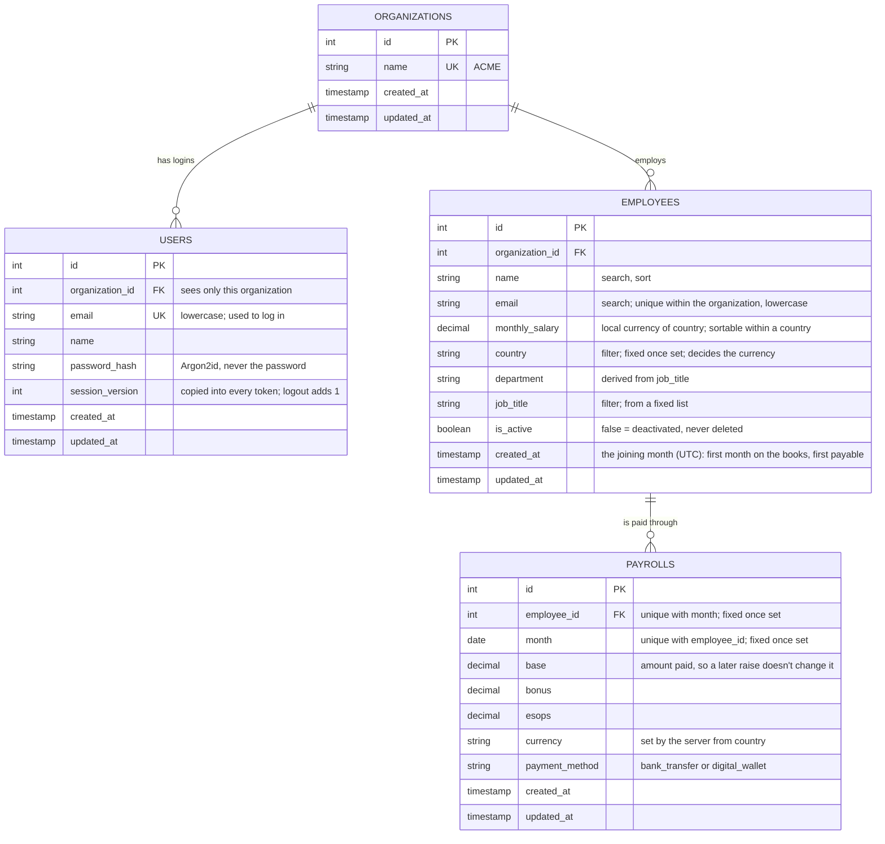
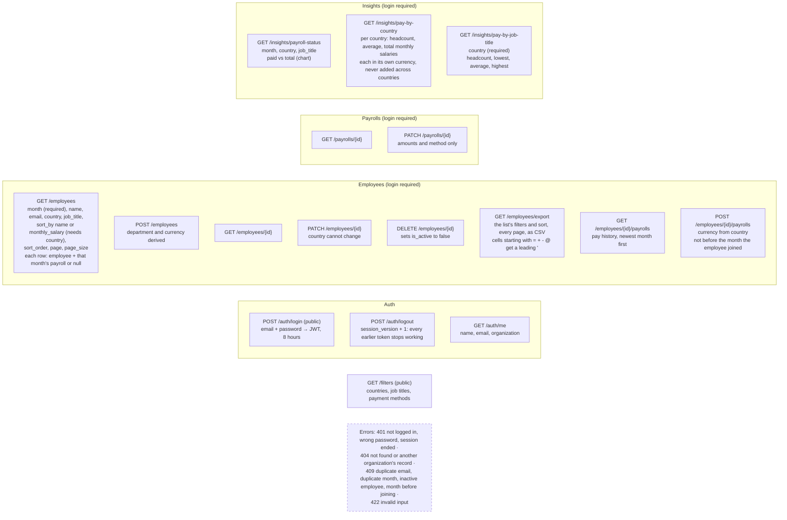
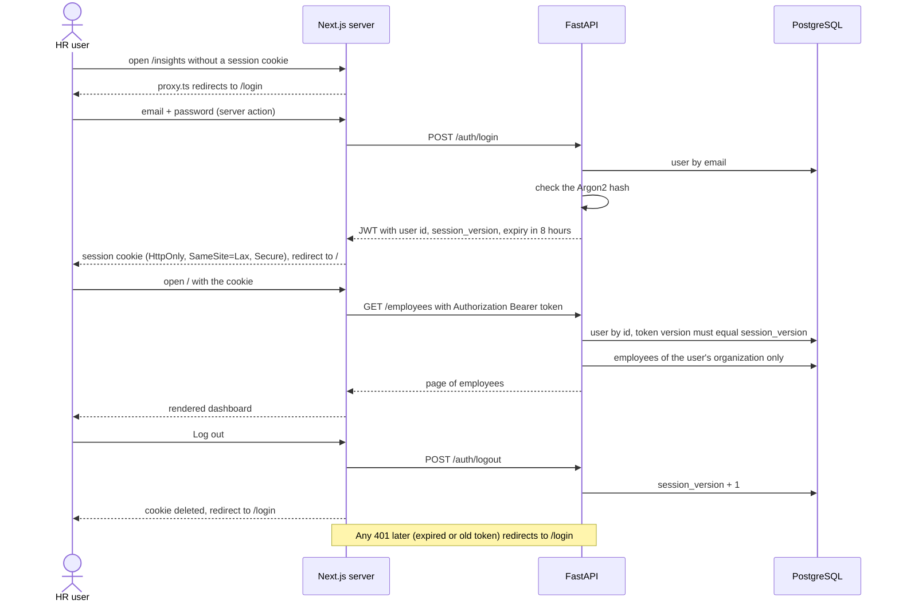
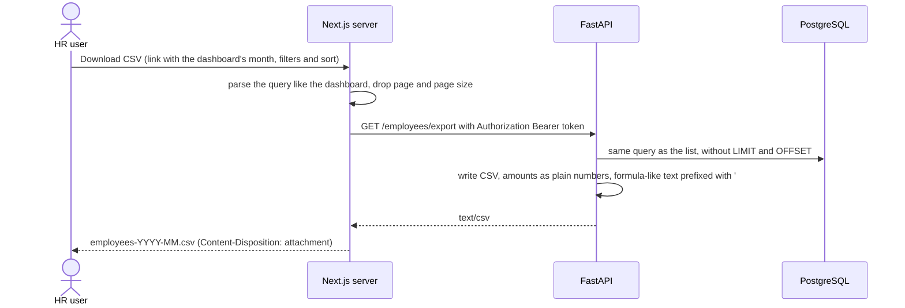
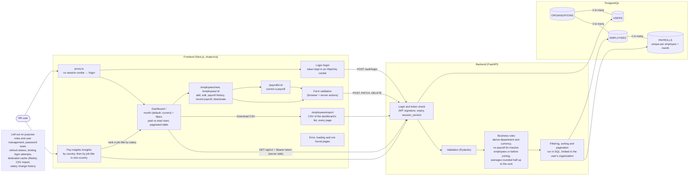

# Diagrams

Derived from `REQUIREMENTS.md` (up to "org level simple stateless auth") and the code as built,
including what was added after review: pay by country and average salaries, payroll history, the
CSV export, and no payrolls before the month an employee joined. Deactivation stays
`DELETE /employees/{id}`, which sets `is_active` to false. `init.png` adds server-side pagination.

## Core data model

Every query is limited to the logged-in user's organization. Payrolls reach their organization
through the employee, so the fact is stored once.

## API (`/api/v1`)

## Login and logout

## CSV export

The browser only talks to the frontend, so the download goes through a route handler that adds
the token, the same way pages fetch data.

## Requirements across the stack

