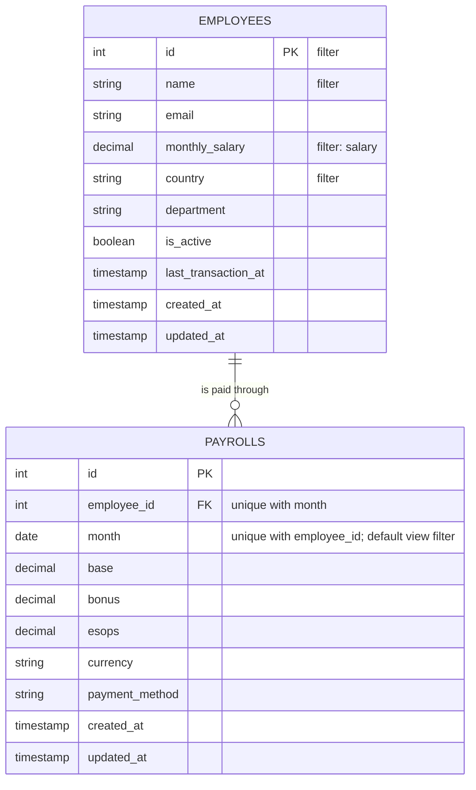
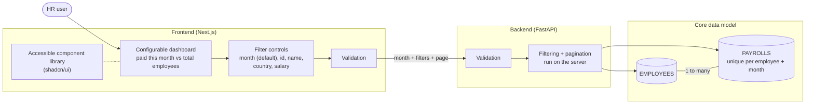

# Diagrams

Derived from `REQUIREMENTS.md`, with `init.png` filling in details the log does not cover
(dashboard insight, server-side pagination).

## Core data model

## Requirements across the stack

