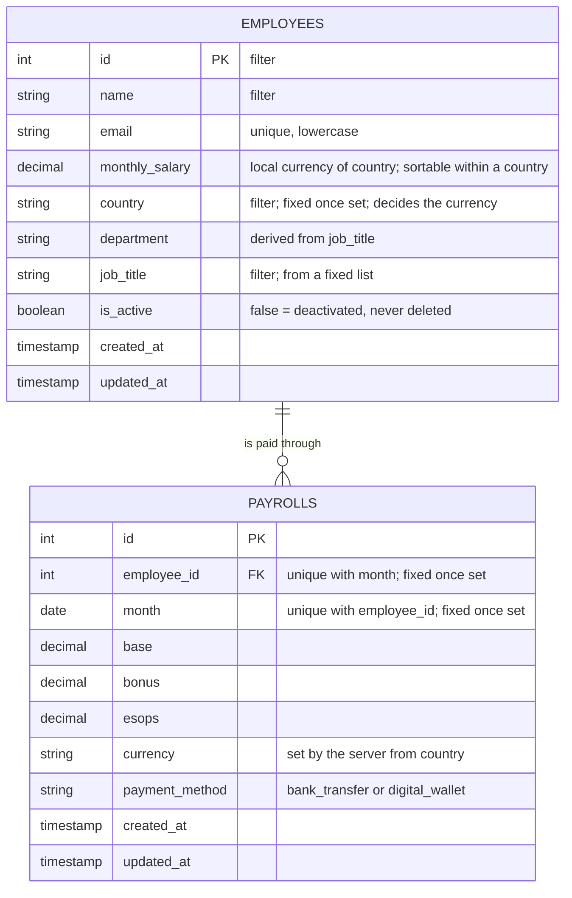
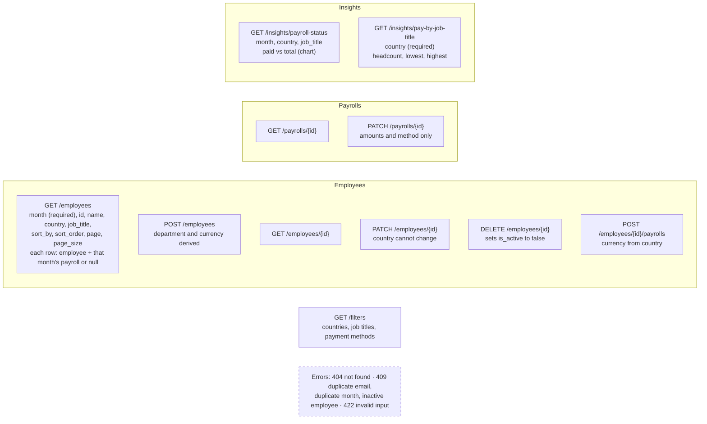

# Diagrams

Derived from `REQUIREMENTS.md` (up to "NEXT STEPS and frontend views planning") and the code as
built. Deactivation stays `DELETE /employees/{id}`, which sets `is_active` to false, as line 51
says. `init.png` adds server-side pagination.

## Core data model

## API (`/api/v1`)

## Requirements across the stack

```mermaid
flowchart LR
    hr(["HR user"])

    subgraph fe["Frontend (Next.js, shadcn/ui)"]
        dash["Dashboard /<br/>month (default: current) + filters<br/>paid vs total chart, paginated table"]
        insightsPage["Pay by job title /insights<br/>one country at a time"]
        employeePages["/employees/new, /employees/:id<br/>add, edit, record payroll, deactivate"]
        payrollPage["/payrolls/:id<br/>correct a payroll"]
        feval["Form validation<br/>(browser + server actions)"]
        errorPage["Error, loading and not-found pages"]
    end

    subgraph be["Backend (FastAPI)"]
        beval["Validation (Pydantic)"]
        services["Business rules<br/>derive department and currency,<br/>no payroll for inactive employees"]
        query["Filtering, sorting and pagination<br/>run in SQL"]
    end

    subgraph data["PostgreSQL"]
        emp[("EMPLOYEES")]
        pay[("PAYROLLS<br/>unique per employee + month")]
    end

    out["Left out on purpose:<br/>authentication, dedicated cache (Redis)"]

    hr --> dash
    hr --> insightsPage
    insightsPage -- "rank a job title by salary" --> dash
    dash --> employeePages --> payrollPage
    employeePages --> feval
    payrollPage --> feval
    dash -- "GET /api/v1 (server side)" --> beval
    insightsPage --> beval
    feval -- "POST, PATCH, DELETE" --> beval
    beval --> services --> query
    query --> emp
    query --> pay
    emp -- "1 to many" --- pay

    style out stroke-dasharray: 5 5
```

