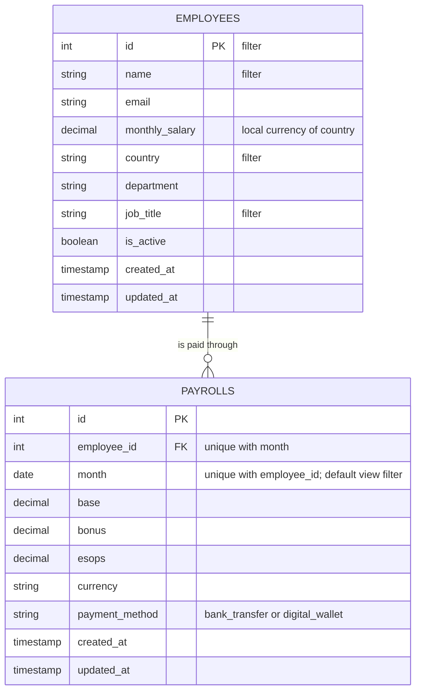
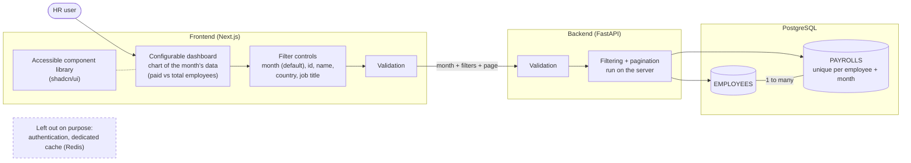

# Diagrams

Derived from `REQUIREMENTS.md` (up to the "updated filters" entry) and the current schema
(migration `0002`). `init.png` fills in details the log does not cover: the "paid vs total"
insight and server-side pagination.

## Core data model

## Requirements across the stack

